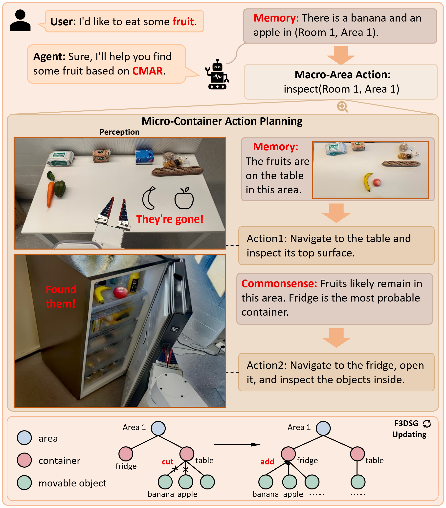
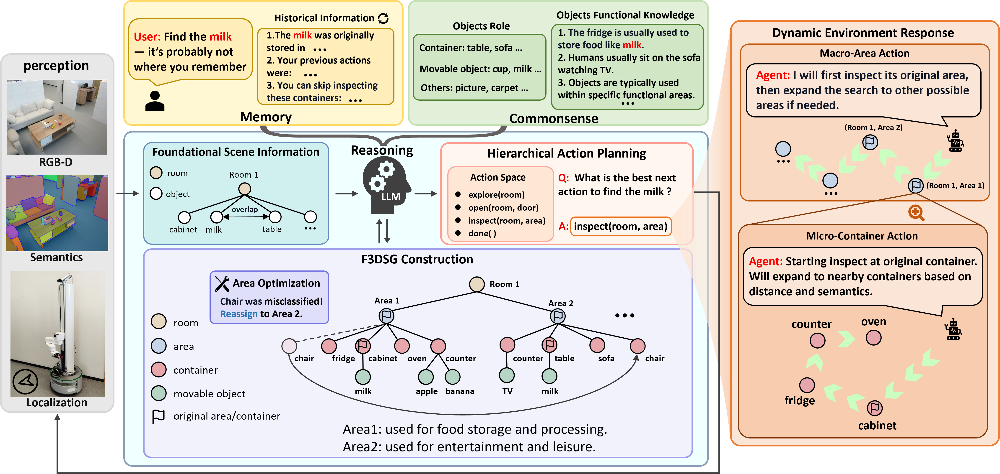

<p align="center"></p>

# CMAR-search

**Commonsense and Memory Augmented Reasoning for Object Search in Dynamic Interactive Environments**  
Kaiyao Liao, Qingfeng Li, Xinlei Zhang, Chen Chen, Qing Sun, Jianwei Niu  
**2026 IEEE International Conference on Robotics and Automation (ICRA), pp. 18586–18593**

[Project page](https://starry-curry-30.github.io/cmar-project/) · [Paper — IEEE Xplore](https://ieeexplore.ieee.org/document/11697035/) · [Video](https://youtu.be/1Qv1jwpRiYA) · [DOI](https://doi.org/10.1109/ICRA57385.2026.11697035)



CMAR-search combines commonsense about functional areas with accumulated memory for interactive object search in changing environments. Its Functional 3D Scene Graph (F3DSG) supports area-level planning and container-level inspection.

## Release scope

This is the authors' selected research-code snapshot, based on MoMa-LLM. The original Python package name `moma_llm` is retained. The release includes the agent, mapping and navigation modules, object-search tasks, configuration, and a small real-world scene description. Simulator datasets, model weights, experiment outputs, and previously accumulated runtime state are not included.

This snapshot contains development settings. It is not a complete collection of the configurations and evaluation runs behind every paper table. For example, its container-scoring implementation uses weights 0.3/0.6/0.1, whereas the paper describes 0.4/0.4/0.2. These implementation values have been preserved. Static checks have been performed; full GPU simulator experiments have not been rerun for this release.

## Environment and installation

Start with an iGibson environment and its licensed assets, following the [official installation instructions](https://stanfordvl.github.io/iGibson/installation.html) and [dataset instructions](https://stanfordvl.github.io/iGibson/dataset.html). GPU rendering and a working display are required by the interactive simulator setup. This project inherits a legacy PyTorch 1.12 / CUDA 11.3 dependency baseline from MoMa-LLM; `requirements.txt` is a dependency list, not a fully tested lockfile for current systems.

```bash
git clone https://github.com/starry-curry-30/CMAR-search.git
cd CMAR-search
# Activate your iGibson environment first.
python -m pip install -r requirements.txt --extra-index-url https://download.pytorch.org/whl/cu113
python scripts/prepare_runtime.py
```

Download and configure iGibson's assets and interactive scenes separately. Confirm that iGibson itself runs before launching this agent. No simulator data is distributed here.

## Configure and run

The selected snapshot uses the `deepseek-chat` model via an OpenAI-compatible client. Export your own credentials in the shell:

```bash
export DEEPSEEK_API_KEY="YOUR_API_KEY"
export CMAR_LLM_BASE_URL="https://api.deepseek.com"
python run_agent.py
```

API calls incur charges with your provider. Credentials are read only from environment variables; `.env.example` documents the settings and is not loaded automatically. `OPENAI_API_KEY` is accepted as an alternative credential variable, but when changing providers you must also set `CMAR_LLM_BASE_URL` and update model names in `run_agent.py`.

Run from the repository root. Edit `configs/moma_llm.yaml` for scene split, agent, episode counts, and simulator options. W&B logging is offline by default; `WANDB_ENTITY` is optional. SentenceBERT defaults to `sentence-transformers/all-MiniLM-L6-v2`; set `CMAR_SBERT_MODEL` to use a local copy. The first model load may require a download.

`realworld.txt` is the small scene-description example read by `determine_area_functions`; replace it with your own scene description when using that branch of the implementation. Runtime files are generated in the working directory, while saved visualization frames use `runtime/`. The preparation script preserves existing state. Use a fresh checkout for independent experiments; the agent resets parts of its state when episodes start.

## Structure

- `run_agent.py`: agent construction and evaluation entry point.
- `moma_llm/llm/`: commonsense reasoning, functional area grouping, and language-model client.
- `moma_llm/env/`: hierarchical planning and simulator interfaces.
- `moma_llm/topology/`: mapping, scene graphs, and room graphs.
- `moma_llm/navigation/`: frontiers and navigation.
- `moma_llm/tasks/`: object sampling and interactive search tasks.
- `configs/`: runtime configuration.



## Citation

Please cite the published IEEE paper:

```bibtex
@inproceedings{liao2026cmar,
  author    = {Liao, Kaiyao and Li, Qingfeng and Zhang, Xinlei
               and Chen, Chen and Sun, Qing and Niu, Jianwei},
  title     = {{CMAR-search}: Commonsense and Memory Augmented
               Reasoning for Object Search in Dynamic
               Interactive Environments},
  booktitle = {2026 IEEE International Conference on Robotics
               and Automation (ICRA)},
  year      = {2026},
  pages     = {18586--18593},
  publisher = {IEEE},
  doi       = {10.1109/ICRA57385.2026.11697035},
  url       = {https://ieeexplore.ieee.org/document/11697035/}
}
```

## Acknowledgments and license

This implementation builds on [MoMa-LLM](https://github.com/robot-learning-freiburg/MoMa-LLM), by Daniel Honerkamp, Martin Büchner, Fabien Despinoy, Tim Welschehold, and Abhinav Valada, *Language-Grounded Dynamic Scene Graphs for Interactive Object Search with Mobile Manipulation*. Please also credit their work when using the inherited components.

The original [LICENSE](LICENSE), including its Toyota notice and Creative Commons Attribution-NonCommercial-ShareAlike 4.0 terms, and existing source-file notices are retained unchanged. This release does not replace those terms with a permissive commercial license. Simulator assets and other dependencies retain their own licenses. Research figures are from the CMAR-search manuscript.
